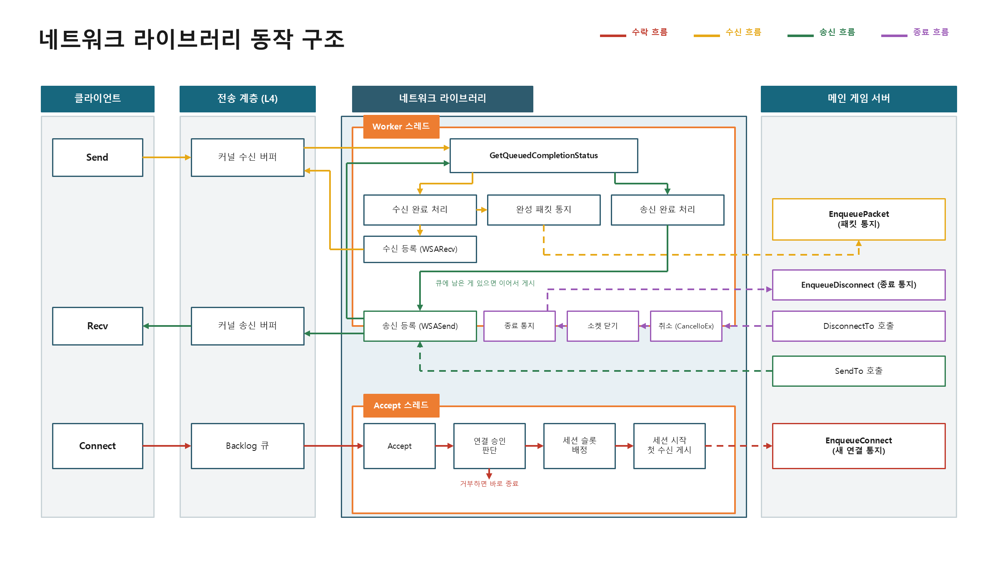
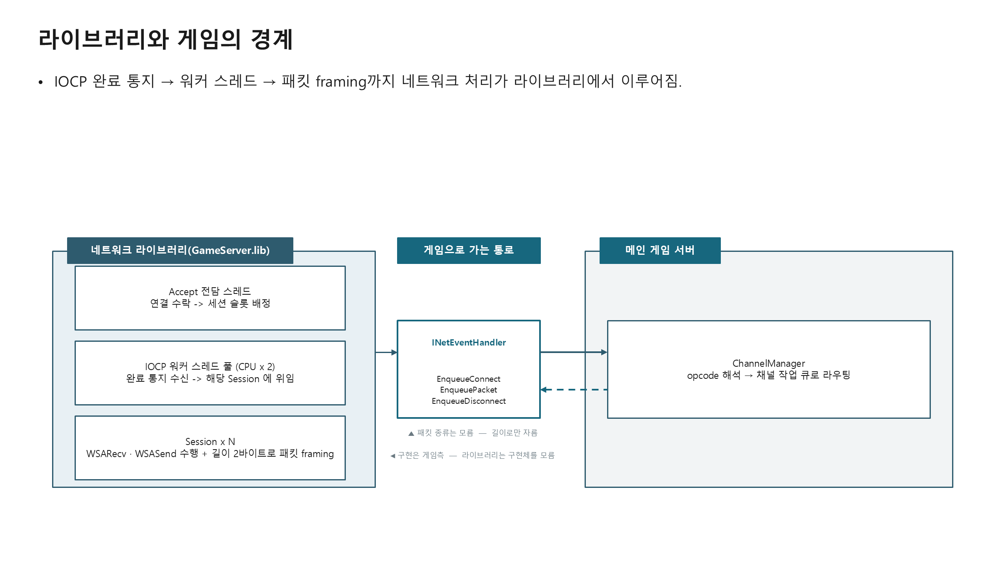
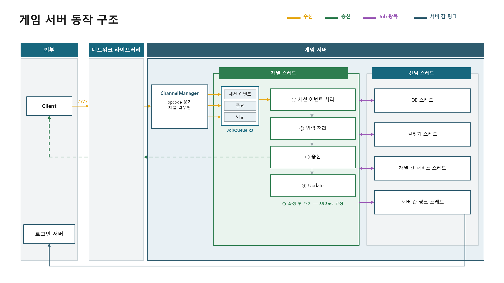
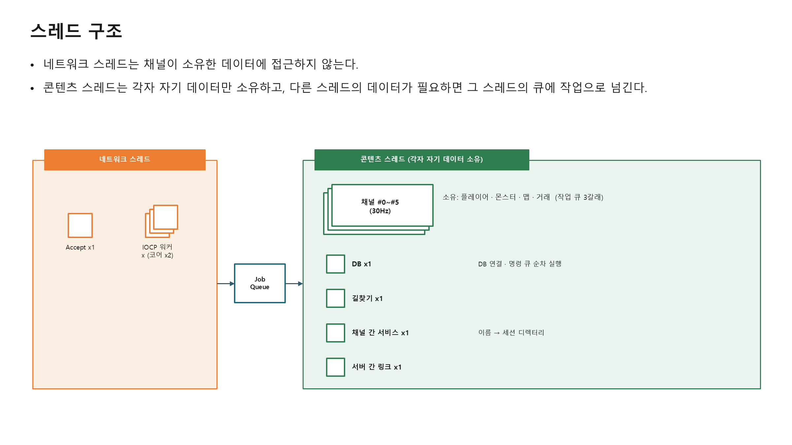

# KYS_NetworkGame

C++17 / Win32 IOCP 기반 MMORPG 서버 학습 프로젝트입니다. 네트워크 라이브러리, 로그인 서버, 게임 서버를 직접 설계하고 구현했습니다.

| 항목 | 값 |
|---|---|
| 언어 · 표준 | C++17 (MSVC v143, x64, Unicode) |
| 네트워크 | Win32 IOCP (Winsock2) |
| 저장소 | MySQL 8 (MySQL Connector/C) |

## 프로젝트 소개

MapleStory 같은 2D MMORPG의 서버를 밑바닥부터 만들어 보는 프로젝트입니다. 세 가지를 목표로 삼았습니다.

- **네트워크 IO의 라이브러리화** - IOCP 완료 통지, 워커 스레드, 세션 관리, 패킷 framing까지를 게임과 무관한 정적 라이브러리(`GameServer.lib`)로 분리했습니다. 라이브러리는 패킷의 종류를 모르고 "맨 앞 2바이트 = 길이" 규약으로 경계만 잘라 게임 계층에 넘깁니다. 같은 라이브러리 위에서 로그인 서버와 게임 서버가 함께 돕니다.
- **로그인 서버의 프로세스 분리** - 계정 인증을 별도 프로세스(`LoginServer.exe`)로 떼어, 로그인 쪽 장애가 게임 서버에 번지지 않게 했습니다. 게임 서버는 비밀번호를 모르고, 60초짜리 일회용 토큰을 서버 간 링크로 검증해 접속을 받습니다. 중복 접속 판정도 로그인 서버 한 곳에서 내립니다.
- **채널 단위 스레드 소유와 서버 권위** - 게임 서버(`ServerApp.exe`)는 채널 하나를 스레드 하나가 전부 소유하는 구조로, 채널 안의 게임 상태에는 락이 없습니다. 이동, 전투, 몬스터 AI, 길찾기, 채팅, 거래의 모든 판정은 서버가 내리며, DB 왕복과 길찾기처럼 느린 작업은 전담 스레드가 맡아 30Hz 게임 루프를 막지 않습니다.

이 프로젝트는 설계 결정 과정 자체를 중요하게 다룹니다. 각 결정에 대해 "왜 이렇게 했는가, 다른 대안은 무엇이었나, 트레이드오프는 무엇인가"를 답할 수 있도록 만들었고, 번복한 결정도 이력으로 남겼습니다.

## 전체 구조

### 프로세스 구성

세 개의 프로세스가 세 개의 포트로 통신합니다.

| 프로세스 | 역할 | 포트 |
|---|---|---|
| `LoginServer.exe` | 계정 생성, 비밀번호 해시 검증, 일회용 토큰 발급, 중복 로그인 판정 | 7001 (클라이언트), 7002 (서버 간) |
| `ServerApp.exe` | 게임 서버 본체 - 채널 6개 x 30Hz 게임 루프, 이동/전투/몬스터/아이템/거래/저장 | 7777 (클라이언트) |
| `GameClient.exe` | 시각 클라이언트 (ImGui + DX11) | - |
| `DummyClient.exe` | 부하 테스트 봇 - 실제 클라이언트 프로토콜을 그대로 재생 (1000 CCU 검증) | - |

`GameClient.exe`는 서버 동작을 눈으로 확인하기 위한 보조 구성요소입니다.

접속 흐름은 두 단계입니다. 클라이언트가 7001에서 인증받아 토큰과 게임 서버 주소를 얻고, 7777로 접속해 토큰을 제시하면, 게임 서버가 7002로 로그인 서버에 검증을 요청해 계정을 확정합니다.

### 빌드 계층

```
[ServerApp / LoginServer / GameClient / DummyClient / Tests]   (.exe)
        |  둘 다 참조
        v
[GameCommon.lib]   게임 도메인 - 패킷 종류(opcode)와 직렬화, 게임 상수, 서버·클라 공유 로직(이동 스텝·통행 격자·길찾기)
        |  단방향 - 역참조 금지
        v
[GameServer.lib]   인프라 - IOCP 엔진, 세션 풀, 오브젝트 풀, 링버퍼, 동기화, 타이머, 로거, 설정 로더
```

의존성은 한 방향입니다. `GameServer.lib`는 `GameCommon.lib`를 모르고, 패킷의 의미도 모릅니다. 이 경계는 프로젝트 참조로 강제되어 컴파일 타임에 위반이 막힙니다.

### 네트워크 라이브러리 동작 구조



Accept 스레드 하나가 연결을 받아 세션 슬롯을 배정하고, IOCP 워커 스레드 풀(코어 x 2)이 송수신 완료를 처리합니다. 세션은 자기 소켓의 WSARecv/WSASend를 직접 수행하고, 길이 규약으로 잘라낸 완성 패킷만 게임 쪽에 통지합니다.

### 라이브러리와 게임의 경계



라이브러리가 게임으로 가는 통로는 `INetEventHandler` 인터페이스 하나이고 메서드는 셋뿐입니다 - 새 연결, 완성 패킷, 연결 종료. 게임 쪽 `ChannelManager`가 이를 구현해 opcode를 해석하고 채널 작업 큐로 라우팅합니다.

### 게임 서버 동작 구조



채널 스레드는 33.3ms 고정 tick마다 세션 이벤트 처리, 입력 처리, 송신, Update 순으로 돕니다. 송신은 수신자별로 한 번만 직렬화해 누적 버퍼에 쌓고 tick 끝에 세션당 한 번씩 보냅니다.

### 스레드 구조



네트워크 스레드는 채널이 소유한 데이터에 접근하지 않습니다. 콘텐츠 스레드(채널 6개, DB, 길찾기, 채널 간 서비스, 서버 간 링크)는 각자 자기 데이터만 소유하고, 다른 스레드의 데이터가 필요하면 그 스레드의 작업 큐에 Job으로 넘깁니다.

## 솔루션 구성

`KYS_NetworkGame/KYS_NetworkGame.sln` 하나에 7개 프로젝트가 있습니다.

| 프로젝트 | 종류 | 내용 |
|---|---|---|
| [`GameServer`](KYS_NetworkGame/GameServer/) | .lib | 네트워크 라이브러리 - `Network/IOCP/` (IOCPServer, Session, SessionPool), `Core/Memory/` (ObjectPool, RingBuffer), `Core/Thread/` (Spinlock, JobQueue), `Core/Log/`, `Core/Config/`, `Protocol/` (직렬화 버퍼) |
| [`GameCommon`](KYS_NetworkGame/GameCommon/) | .lib | 게임 도메인 공유 계층 - `Protocol/` (PacketType, 게임 패킷), `MapData/` (맵·포탈·통행 격자), `Pathfinding/` (A* + JPS), `ItemData/` |
| [`ServerApp`](KYS_NetworkGame/ServerApp/) | .exe | 게임 서버 - `Game/Channel/` (채널 스레드, 작업 큐), `Game/Player`·`Monster`·`World`·`Combat`·`Item`·`Path`, `DataBase/` (DB 스레드), `SharedService/`, `Monitor/` |
| [`LoginServer`](KYS_NetworkGame/LoginServer/) | .exe | 로그인 서버 - `Auth/` (PBKDF2, 토큰 저장소), `Handler/`, `DataBase/`, `Network/` (서버 간 링크) |
| [`GameClient`](KYS_NetworkGame/GameClient/) | .exe | 시각 클라이언트 - `Game/`, `Network/`, `Handler/`, `Render/` |
| [`DummyClient`](KYS_NetworkGame/DummyClient/) | .exe | 부하 테스트 봇 - `StressTest/` |
| [`Tests`](KYS_NetworkGame/Tests/) | .exe | 단위 테스트 (googletest) - 풀, 링버퍼, 락프리 큐, 직렬화, 길찾기, 세션 풀, 설정 파서 등 |

그 밖의 폴더:

| 폴더 | 내용 |
|---|---|
| [`KYS_NetworkGame/Data/`](KYS_NetworkGame/Data/) | 게임 정적 데이터 - `maps.csv`, `spawns.csv`, `portals.csv`, `items.csv`, `monsters.yml`, 통행 격자. 서버가 부팅 때 읽고 검증합니다 |
| [`KYS_NetworkGame/ThirdParty/`](KYS_NetworkGame/ThirdParty/) | MySQL Connector/C 8.4, rapidyaml 0.15, Dear ImGui 1.91, googletest 1.16 (모두 vendored) |

## 시연 영상

https://github.com/user-attachments/assets/08bc36a8-5047-4845-b069-8e308fc4296b
